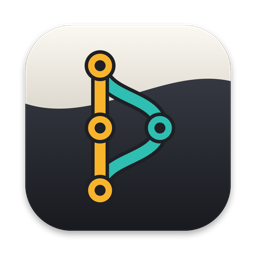
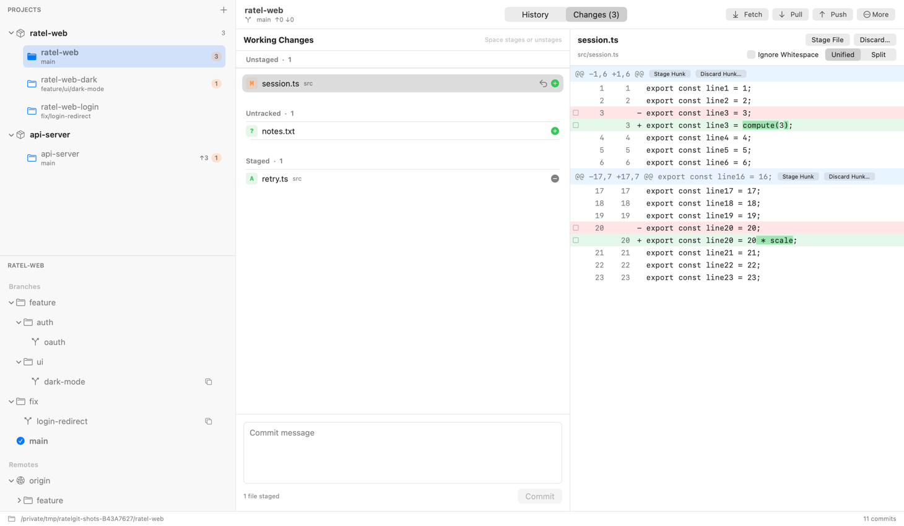
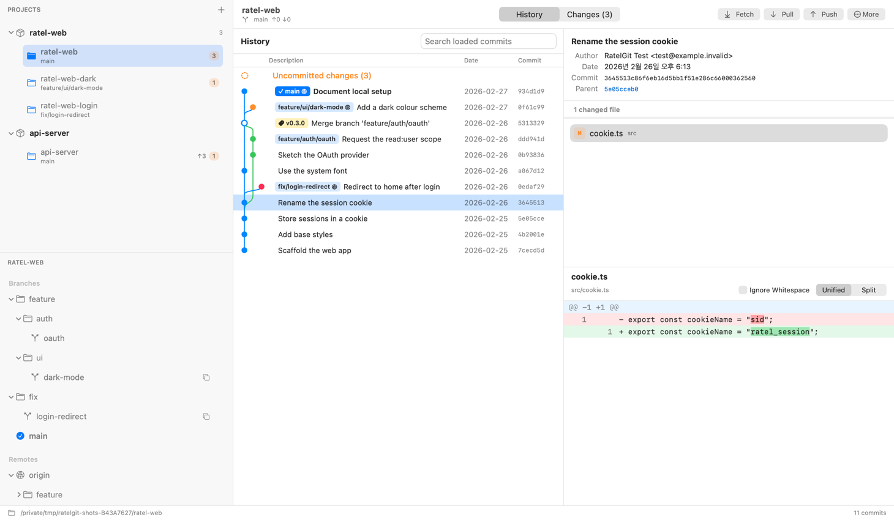

# ratelgit

[English](README.md) · 한국어



ratelgit은 worktree를 중심에 둔 macOS Git 클라이언트입니다. 사이드바에 저장소를 추가하고 그 아래 worktree를 고르면 커밋 그래프, 변경 파일, diff가 함께 바뀌어서, 여러 프로젝트와 작업 폴더를 오가도 흐름이 끊기지 않습니다. 이름은 벌에 몇 번 쏘여도 물러서지 않는 벌꿀오소리(ratel)에서 따왔습니다. Swift와 SwiftUI로 만들었고, 이미 설치된 Git 명령줄을 사용합니다.

> AI와 함께 만들었습니다. 방향은 제가 정했고, 코드·테스트·문서는 [Codex](https://openai.com/codex/)와 [Claude Code](https://claude.com/claude-code)와의 세션에서 작성했습니다. [왜 만들었나](#왜-만들었나)를 참고하세요.



스크린샷은 가상의 커밋으로 만든 예제 저장소를 렌더링한 것입니다.

## 목차

- [왜 만들었나](#왜-만들었나)
- [설치](#설치)
- [빠른 시작](#빠른-시작)
- [기능](#기능)
- [단축키](#단축키)
- [제한 사항](#제한-사항)
- [개발](#개발)
- [라이선스](#라이선스)

## 왜 만들었나

같은 저장소의 worktree를 여러 개 열어 두고 일하는데, Git 클라이언트에 바라는 것은 단순했습니다. worktree를 고르면 그 그래프와 diff가 보이는 것입니다. Sourcetree, Fork, GitKraken은 일상적인 Git 기능을 잘 다루지만 worktree 사이를 오가는 일이 중심은 아닙니다. ratelgit은 그 기본기(브랜치, 커밋 그래프, 스테이징, diff 뷰어, fetch·pull·push)를 가져오고 worktree 목록을 맨 앞에 두었습니다.

제가 한 일: 조회 전용 브라우저에서 시작해 스테이징·커밋·원격 작업을 더하는 순서로 범위를 정했고, 안전 규칙(pull은 fast-forward만, push는 설정된 upstream으로의 일반 push)을 골랐습니다. 구현·테스트·문서는 Codex와 Claude Code로 작성했고, 단계마다 독립 리뷰를 거쳤습니다.

## 설치

아직 패키지 릴리스가 없어 소스에서 빌드합니다. macOS 14 이상과 Xcode 15 이상이 필요합니다. Xcode가 기본 개발자 디렉터리가 아니면 `DEVELOPER_DIR`에 Xcode의 `Contents/Developer` 경로를 지정하세요.

```sh
git clone https://github.com/likeratel/ratelgit.git
cd ratelgit
./scripts/run-app.sh
```

스크립트는 `.build/RatelGit.app`을 만들고 실행합니다. Spotlight로 실행하려면 번들을 응용 프로그램 폴더로 복사하세요.

```sh
./scripts/run-app.sh --build-only
cp -R .build/RatelGit.app ~/Applications/
```

## 빠른 시작

1. `⌘O`를 눌러 저장소 또는 연결된 worktree 폴더를 고릅니다. **Projects**에 추가되고 다시 실행해도 남아 있습니다. 저장소는 여러 개 추가할 수 있습니다.
2. 프로젝트 아래 worktree를 고르거나, `⌥⌘[`, `⌥⌘]`로 그 프로젝트의 worktree를 차례로 오가거나, `⌘P`를 눌러 프로젝트·worktree·브랜치 이름 일부를 입력합니다. 각 worktree 행에 브랜치, 변경 파일 수, upstream 대비 앞선·뒤처진 커밋 수가 표시됩니다.
3. 기본 화면은 **History**(`⌘1`)입니다. 커밋을 선택하면 오른쪽에 메시지, 파일, diff가 나옵니다.
4. **Changes**(`⌘2`)로 바꿔 파일·hunk·줄 단위로 스테이징하고 메시지를 쓴 뒤 **Commit**을 누릅니다.

## 기능

### 프로젝트와 worktree

- 사이드바에 추가한 저장소가 모두 나오고, 각각 펼치면 worktree가 보입니다. 목록은 다시 실행해도 유지되며, 폴더가 사라진 프로젝트는 오류 대신 unavailable로 표시됩니다. 우클릭 메뉴로 목록에서 뺄 수 있습니다.
- worktree를 바꾸면 그 작업 폴더의 그래프, 브랜치, 변경 파일, upstream 상태를 다시 읽고, 마지막으로 고른 worktree의 결과만 화면에 반영합니다.
- 커밋 메시지 초안은 앱을 사용하는 동안 worktree마다 따로 유지됩니다.
- `⌘P` 빠른 전환: 프로젝트, worktree, 현재 프로젝트의 브랜치를 퍼지 검색해 키보드(`↑` `↓`, `Return`, `Esc`)로 이동합니다. 브랜치를 고르면 History가 그 브랜치로 필터됩니다.

### History

- 기본으로 모든 로컬 브랜치, 원격 브랜치, 태그와 HEAD를 한 그래프에 그립니다. 메인 라인은 색을 유지하고 머지된 브랜치가 그쪽으로 합류합니다.
- 열: 그래프, ref 배지와 메시지, 작성자, 날짜, 짧은 해시. 목록이 좁아지면 작성자와 날짜 열을 숨깁니다.
- worktree에 변경이 있으면 맨 위에 **Uncommitted changes (n)** 행이 나오고, 누르면 Changes로 넘어갑니다.
- 커밋을 500개씩 불러오고, 끝까지 스크롤하면 다음 페이지를 불러옵니다. 부모가 다음 페이지에 있는 레인은 아래로 계속 이어집니다.
- Fork식 필터: 사이드바의 브랜치, 원격 폴더, 폴더에 마우스를 올려 깔때기 버튼을 누르면 거기서 도달 가능한 커밋만 보입니다. 여러 개를 켜면 합집합입니다. 목록 위 바에 켜진 필터와 Clear 버튼이 있고, worktree의 HEAD가 필터 밖이면 알려 줍니다. `⌘⇧A`는 "현재 브랜치만"을 켜고 끕니다. 필터는 앱을 사용하는 동안 프로젝트별로 유지됩니다.
- 불러온 커밋 안에서 메시지, 작성자, 날짜, 해시, 참조 이름으로 검색합니다.
- 사이드바에서 브랜치, 태그, stash를 누르면 그 참조가 가리키는 커밋을 보여 줍니다.



### Changes

- 파일을 충돌, unstaged, untracked, staged로 나눠 보여 줍니다. 행이나 diff 머리글에서 파일 단위로 stage·unstage·버리기를 합니다.
- diff에서 hunk 머리글의 버튼으로 hunk 하나를, 줄 앞 체크로 고른 줄만 stage·unstage·버리기 할 수 있습니다.
- 파일 목록에 포커스가 있으면 `↑` `↓`로 파일을 옮기고 `Space`로 선택한 파일을 stage·unstage합니다. 커밋 메시지 입력은 가로채지 않습니다.
- 버리기는 항상 먼저 확인합니다. untracked 파일을 버리면 파일이 삭제되며, 확인 문구에 그렇게 적혀 있습니다.
- 스테이징한 변경과 메시지가 있고 충돌 파일이 남아 있지 않을 때만 커밋할 수 있습니다.

### Diff

- Unified와 Split 보기를 지원하며 둘 다 줄 번호를 표시합니다.
- 바뀐 줄 쌍에서는 달라진 단어만 진하게 강조합니다.
- **Ignore Whitespace**는 공백만 바뀐 부분을 숨깁니다(`git diff -w`). 이런 diff는 되돌려 적용할 수 없어서, 켜져 있는 동안 hunk·줄 단위 스테이징은 꺼집니다.
- Split 보기는 가장 긴 줄의 실제 너비를 재므로, 긴 줄이나 한글처럼 넓은 글자도 자기 열 안에 머뭅니다.

### 브랜치, stash, 원격

- 로컬 브랜치와 원격 브랜치를 `/` 기준 폴더 트리로 보여 주며, 원격은 remote 이름이 최상위 폴더입니다. 현재 worktree가 체크아웃한 브랜치는 강조되고, 다른 worktree에서 체크아웃 중인 브랜치에는 아이콘이 붙고 도움말에 그 worktree가 나옵니다.
- 로컬 브랜치 메뉴: Check Out, Merge into Current Branch, Rebase Current Branch onto This, Check Out in New Worktree…, Rename…, Delete…, 필터. 삭제는 먼저 확인하고, 완전히 병합되지 않은 브랜치는 강제 삭제를 한 번 더 따로 확인합니다.
- 원격 브랜치 메뉴: 로컬 추적 브랜치로 체크아웃, 필터. 태그는 필터할 수 있습니다.
- stash 메뉴: Apply(커밋 ID로 적용하므로 stash 번호가 밀려도 다른 stash를 적용하지 않음), 확인을 거치는 Drop….
- merge나 rebase가 충돌로 멈추면 오류를 보여 주고, 충돌 파일이 Changes에 나오며, 배너에서 **Abort**할 수 있습니다. rebase 계속은 터미널에서 `git rebase --continue`, merge 마무리는 Changes에서 커밋합니다.
- **More**에서 HEAD로부터 브랜치를 만들거나 변경을 stash합니다. Fetch, Pull, Push는 상단에 있습니다.

## 단축키

| 단축키  | 동작                                      |
| ------- | ----------------------------------------- |
| `⌘O`    | 저장소 추가                               |
| `⌘P`    | 프로젝트·worktree·브랜치로 빠른 전환      |
| `⌘R`    | 새로 고침                                 |
| `⌘1`    | History                                   |
| `⌘2`    | Changes                                   |
| `⌘⇧A`   | History에서 "현재 브랜치만" 켜고 끄기     |
| `⌥⌘[`   | 프로젝트의 이전 worktree                  |
| `⌥⌘]`   | 프로젝트의 다음 worktree                  |
| `Space` | 선택한 파일 stage·unstage(파일 목록 포커스) |

## 제한 사항

- 검색은 지금까지 불러온 커밋 안에서만 합니다.
- 머지 커밋의 파일은 첫 번째 부모와 비교합니다.
- History 필터는 앱을 사용하는 동안만 유지됩니다.
- hunk·줄 단위 스테이징은 추적 중인 텍스트 파일에서 동작합니다. untracked, 새 파일, 충돌 변경은 파일 단위로 스테이징합니다.
- 실행 취소, cherry-pick, revert, reset, interactive rebase, 드래그 앤 드롭, 원격 관리, 서브모듈은 지원하지 않습니다. 명령줄을 사용하세요.
- Pull은 fast-forward만 허용합니다. Pull과 Push에는 현재 브랜치의 원격 upstream이 필요합니다.
- 원격 인증에는 기존 Git 자격 증명 설정을 사용하며, ratelgit은 자격 증명을 저장하지 않습니다.

## 개발

```sh
swift build
swift test
```

`swift test`에는 Xcode의 XCTest가 필요합니다. 통합 테스트는 임시 저장소·worktree·로컬 원격 저장소를 만들어 쓰며 사용자의 저장소는 건드리지 않습니다.

구성은 단순합니다. `Sources/RatelGitCore`가 Git을 실행하고 출력을 해석하며, `Sources/RatelGit`에 SwiftUI 앱이 있고, `scripts/make-icon.swift`가 앱 아이콘을 다시 그립니다.

## 라이선스

MIT
