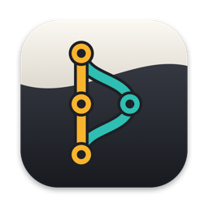
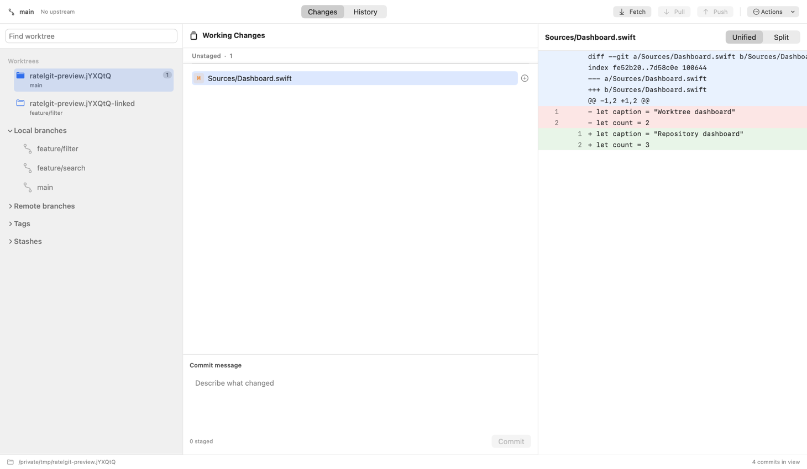
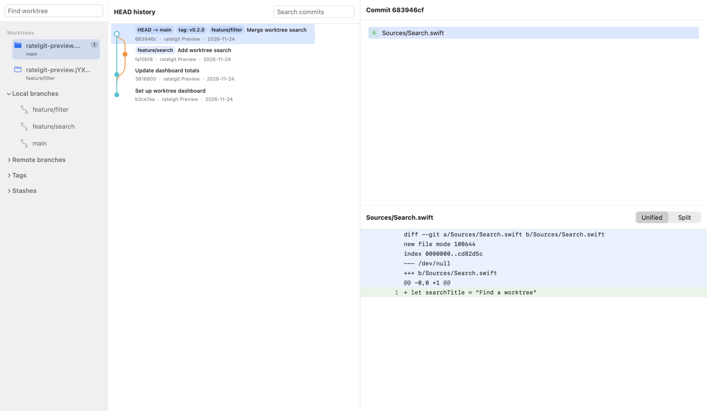

# ratelgit

English · [한국어](README.ko.md)



ratelgit is a macOS Git client built around worktrees. Pick a worktree in the sidebar and its commit graph, changed files and diffs follow, so you can move between several checkouts of one repository without losing your place. It is named after the ratel, the honey badger that does not back off from a few stings. Built with Swift and SwiftUI on top of the Git command line you already have.

> Built with AI. I set the direction; the code, tests and docs were written in sessions with [Codex](https://openai.com/codex/) and [Claude Code](https://claude.com/claude-code). See [Why I built this](#why-i-built-this).



The screenshots are rendered from a sample repository with made-up commits.

## Contents

- [Why I built this](#why-i-built-this)
- [Install](#install)
- [Quick start](#quick-start)
- [Features](#features)
- [Shortcuts](#shortcuts)
- [Limits](#limits)
- [Development](#development)
- [License](#license)

## Why I built this

I keep several worktrees of the same repository open at once, and what I want from a Git client is simple: choose a worktree, then see its graph and its diff. Sourcetree, Fork and GitKraken cover the everyday Git features well, but switching between worktrees is not what they are built around. ratelgit borrows their basics (branches, a commit graph, staging, a diff viewer, fetch, pull and push) and puts the worktree list first.

What I did: decided the scope, starting from a read-only browser and then adding staging, commits and remote actions, and chose the safety rules (pull is fast-forward only, push is a plain push to the configured upstream). The implementation, tests and docs were written with Codex and Claude Code, and each stage went through an independent review round.

## Install

There is no packaged release yet, so build it from source. You need macOS 14 or later and Xcode 15 or later. If Xcode is not the selected developer directory, set `DEVELOPER_DIR` to its `Contents/Developer` path.

```sh
git clone https://github.com/likeratel/ratelgit.git
cd ratelgit
./scripts/run-app.sh
```

The script builds `.build/RatelGit.app` and opens it. To launch it from Spotlight, copy the bundle into your Applications folder:

```sh
./scripts/run-app.sh --build-only
cp -R .build/RatelGit.app ~/Applications/
```

## Quick start

1. Press `⌘O` and choose a repository or any of its linked worktrees.
2. Pick a worktree under **Worktrees**, or step through them with `⌥⌘[` and `⌥⌘]`. Each row shows the branch and the number of changed files.
3. In **Changes**, select a file to read its diff, stage it with the `+` button, write a message and press **Commit**.
4. Switch to **History** to follow the graph, then select a commit to see its files and diff.

## Features

### Worktrees

- Every worktree of the repository is listed with its branch and change count, and the list can be filtered by name or branch.
- Switching a worktree reloads the graph, branches, changed files and upstream status for that checkout.
- A commit message draft stays with its worktree while the app is open.

### Changes

- Files are grouped into unstaged, untracked and staged, and can be staged or unstaged one file at a time.
- Commit is disabled until something is staged, a message is written and no conflicted file is left.

### History

- A colour graph draws branch lanes and merge lines; the mainline keeps its colour and merged branches curve into it.
- Search by message, author, date, hash or ref name.
- Select a local branch, remote branch, tag or stash in the sidebar to browse its history.



### Diff

- Unified and split layouts, both with line numbers.
- The split layout measures the longest line, so long lines and wide characters such as Hangul stay in their own column.

### Branches, stashes and remotes

- Create a branch from the current HEAD, or check out a local branch from its context menu.
- Stash staged, unstaged and untracked changes, and apply a stash from its context menu.
- Fetch, Pull and Push sit in the top bar, next to how far the branch is ahead of or behind its upstream.

## Shortcuts

| Shortcut | Action            |
| -------- | ----------------- |
| `⌘O`     | Open a repository |
| `⌘R`     | Refresh           |
| `⌥⌘[`    | Previous worktree |
| `⌥⌘]`    | Next worktree     |

## Limits

- History shows the latest 400 commits of the selected ref.
- The files of a merge commit are compared with its first parent.
- Staging works on whole files; there is no hunk or line staging, and no discard.
- Pull is fast-forward only. Pull and Push need a remote upstream on the current branch.
- There is no merge, rebase, branch deletion or worktree creation yet. Use the command line for those.
- Remote authentication uses your existing Git credential setup; ratelgit does not store credentials.

## Development

```sh
swift build
swift test
```

`swift test` needs the XCTest that ships with Xcode. The integration tests create temporary repositories, worktrees and a local remote, and never touch your own repositories.

The layout is small: `Sources/RatelGitCore` runs Git and parses its output, `Sources/RatelGit` holds the SwiftUI app, and `scripts/make-icon.swift` redraws the app icon.

## License

MIT
