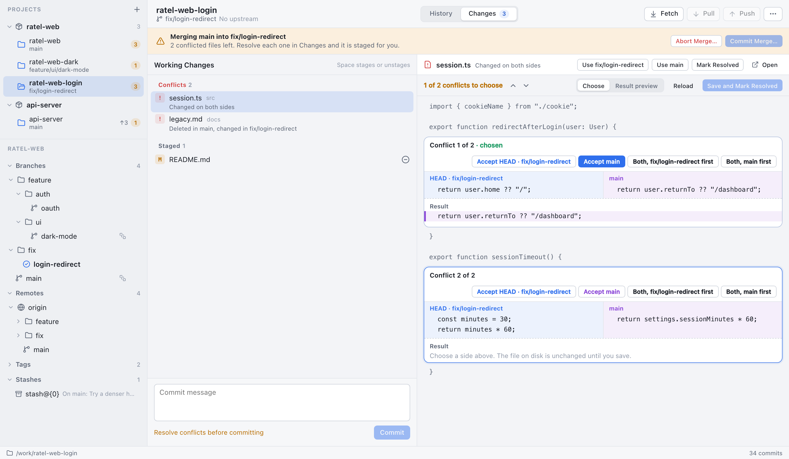

# ratelgit

English · [한국어](README.ko.md)

[](https://github.com/likeratel/ratelgit/actions/workflows/verify.yml)


ratelgit is a Git client built around worktrees, for macOS and Windows. Add your repositories to the sidebar, pick any of their worktrees, and the commit graph, changed files and diffs follow, so you can move between projects and their checkouts without losing your place. It is named after the ratel, the honey badger that does not back off from a few stings. Built with Tauri 2, React, TypeScript and Rust on top of the Git command line you already have.

> Built with AI. I set the direction; the code, tests and docs were written in sessions with [Codex](https://openai.com/codex/) and [Claude Code](https://claude.com/claude-code). See [Why I built this](#why-i-built-this).

> **Verification status.** Developed on macOS (Apple Silicon). The Git core is covered by integration tests against temporary repositories and the UI by unit and browser tests. Windows builds in CI but has not been run. See [Limits](#limits).


The screenshots show made-up sample data.

## At a glance

- **Projects, then worktrees.** Every repository you add sits in the sidebar with its worktrees, each showing its branch, changed files and upstream distance. Jump anywhere with `⌘P`.
- **History first.** The graph of all branches opens by default, with the selected commit's details below it. Filter it to the branches you pick, the way Fork does.
- **Stage exactly what you mean.** Whole files, hunks or single lines, with word-level highlights in the diff.
- **Conflicts without leaving the app.** A banner tracks the merge or rebase, and each conflict chunk shows both sides by branch name so you can pick one, the other or both.
- **Your Git, your credentials.** ratelgit runs the Git already on your computer and stores no passwords or tokens.

## Contents

- [At a glance](#at-a-glance)
- [Why I built this](#why-i-built-this)
- [Install](#install)
- [Quick start](#quick-start)
- [Features](#features)
- [Shortcuts](#shortcuts)
- [Limits](#limits)
- [Trust model](#trust-model)
- [Development](#development)
- [License](#license)

## Why I built this

I keep several worktrees of the same repository open at once, and what I want from a Git client is simple: choose a worktree, then see its graph and its diff. Sourcetree, Fork and GitKraken cover the everyday Git features well, but switching between worktrees is not what they are built around. ratelgit borrows their basics (branches, a commit graph, staging, a diff viewer, fetch, pull and push) and puts the worktree list first.

What I did: decided the scope, starting from a read-only browser and then adding staging, commits, remote actions and conflict resolution, and chose the safety rules (pull is fast-forward only, push is a plain push to the configured upstream, nothing irreversible happens without a confirmation). The first version was a SwiftUI app for macOS; this version moved to Tauri so the same code runs on Windows too, like the other ratel apps. The SwiftUI version is kept on the [`swiftui` branch](https://github.com/likeratel/ratelgit/tree/swiftui); its project list is not carried over, so add your repositories again.

## Install

There is no packaged release yet, so build it from source. You need Git 2.36 or later, Node.js 22, pnpm 10 and a current stable Rust toolchain (plus the [Tauri prerequisites](https://tauri.app/start/prerequisites/) for your platform).

```sh
git clone https://github.com/likeratel/ratelgit.git
cd ratelgit
pnpm install --frozen-lockfile
pnpm tauri build
```

The app is written to `src-tauri/target/release/bundle/`. On macOS the bundle is `RatelGit.app`; the capital letters let Spotlight find it when you type `git`. Copy it to your Applications folder, then delete the copy under `src-tauri/target` so Spotlight does not list both. A locally built app is not signed or notarized.

ratelgit calls the `git` on your `PATH`, then the usual install locations (`/opt/homebrew/bin`, `/usr/local/bin`, `/usr/bin` on macOS; `C:\Program Files\Git\cmd` on Windows). If none is found, or it is older than 2.36, it says so instead of failing with Git's own error.

## Quick start

1. Press `⌘O` (`Ctrl+O` on Windows) and choose a repository or any of its linked worktrees. It is added under **Projects** and stays there after a relaunch. Add as many repositories as you like.
2. Pick a worktree under its project, step through a project's worktrees with `⌥⌘[` and `⌥⌘]`, or press `⌘P` and type part of a project, worktree or branch name. Each worktree row shows its branch, changed files and how far it is ahead of or behind its upstream.
3. **History** (`⌘1`) is the default view. Select a commit and its message, files and diff appear below the list.
4. Switch to **Changes** (`⌘2`) to stage files, hunks or lines, write a message and press **Commit**.

On Windows every `⌘` shortcut uses `Ctrl` instead.

## Features

### Projects and worktrees

- The sidebar lists every repository you added, each with its worktrees. The list is kept across relaunches; a project whose folder disappeared is shown as unavailable instead of failing. Remove a project from its context menu.
- Switching a worktree reloads the graph, branches, changed files and upstream status for that checkout, and only the last worktree you picked reaches the screen, however fast you switch.
- When the window gets focus back, the selected worktree and the sidebar counts are read again quietly, so changes made in a terminal or editor show up. Your selection, draft and scroll position stay.
- The last worktree you used opens again at launch. A commit message draft stays with its worktree while the app is open.
- `⌘P` opens a quick switcher: fuzzy-match projects, worktrees and the branches of the current project with the keyboard (`↑` `↓`, `Return`, `Esc`). Picking a branch filters History to it.

### History

- The commit list fills the top of the window and the selected commit's details fill the bottom: message, author, date, hash and parents with the changed files on the left, the selected file's diff on the right. Drag the divider to give either part more room; the split is remembered.
- By default the graph shows every local branch, remote branch and tag together with HEAD. Lanes and merge lines are drawn in colour; the main line keeps its colour and merged branches curve into it.
- Columns: graph, ref badges and message, author, date and short hash. Author and date hide when the list gets narrow. A remote branch at the same commit as a local one is folded into the local badge as a small globe.
- An **Uncommitted changes (n)** row sits on top when the worktree has changes; clicking it opens Changes.
- History loads 500 commits at a time and fetches the next page as you scroll to the end. Lanes whose parents are on the next page keep running down. The list is virtualized, so long histories scroll smoothly.
- Filter like Fork:
  - Hover a branch, tag, remote folder or branch folder in the sidebar and click its funnel to show only the commits reachable from it. Several filters combine as a union.
  - A bar above the list names the active filters, removes them one by one or clears them all, and tells you when the worktree's HEAD is outside the filter.
  - `⌘⇧A` toggles "current branch only".
  - Filters are kept per project across relaunches.
- Search by message, author, date, hash or ref name within the loaded commits. `↑` `↓` move between commits when the list has focus.
- Clicking a branch, tag or stash in the sidebar selects the commit it points at.

### Changes

- Files are grouped into conflicts, unstaged, untracked and staged. Stage, unstage or discard a whole file from its row or from the diff header.
- In the diff, stage, unstage or discard a single hunk with the buttons on its header, or tick individual lines and act on just those. The core rebuilds the patch from the exact diff you saw and refuses if the file changed in the meantime.
- With the file list focused, `↑` `↓` move between files and `Space` stages or unstages the selected one. `⌘Return` in the message box commits.
- Discarding always asks first. Discarding an untracked file deletes it, and the dialog says so.
- Commit is disabled until something is staged, a message is written and no conflicted file is left.


### Resolving conflicts

- When a merge, rebase, cherry-pick or revert stops (also one started from the command line), a banner says what is being combined, for example "Merging main into fix/login" or "Rebasing topic onto main (step 2 of 3)", and how many conflicted files are left. **Continue** stays disabled until every conflict is resolved and staged; for a merge it opens the prepared commit message for editing, for a rebase it continues without opening an editor and shows the next stop if there is one. **Abort** asks first.
- **Conflicts** is the first group in Changes. Each file says what each side did (changed on both sides, deleted in one branch and changed in the other, added on both sides), named by branch rather than "ours" and "theirs". Whole-file actions: take one side's version, keep or delete a file for delete conflicts, mark the file resolved as it is (with a warning if conflict markers are left), or open it in its default app. A file that could run something when opened (a script, a program, or any file with the executable bit) is only shown in the file manager.
- Selecting a conflicted file shows each conflict chunk with both sides next to each other (and the common base when `merge.conflictStyle` is `diff3` or `zdiff3`), labelled with the names from the markers. Choose one side or both in either order per chunk, see the result under the chunk or as a preview of the whole file, and jump between chunks that still need a choice. **Save and Mark Resolved** is enabled once every chunk has a choice; only then is the file written and staged.
- Before writing, ratelgit checks that the file on disk is still the one it showed you and refuses if it changed. Line endings (LF or CRLF), a missing final newline and the encoding are kept. Binary and non-UTF-8 files, and files whose markers are nested or broken, are not guessed at: they offer only the whole-file actions.



### Diff

- Unified and split layouts, both with line numbers.
- Changed line pairs highlight only the words that differ.
- **Ignore whitespace** hides whitespace-only changes (`git diff -w`). Hunk and line staging is off while it is on, because such a diff cannot be applied back.
- Very large diffs are cut at 4 MB and diffs that are not UTF-8 are shown with replacement characters; in both cases hunk and line staging is off and the file can still be staged whole.

### Branches, stashes and remotes

- Local branches and remote branches are shown as folder trees split on `/`; each remote is a top-level folder. The branch checked out in the current worktree is highlighted, and a branch checked out in another worktree carries an icon whose tooltip names that worktree.
- Local branch menu: Check Out, Merge into the current branch, Rebase the current branch onto it, Check Out in New Worktree…, Rename…, Delete…, and filters. A new worktree goes into a folder you name, next to the project or inside a folder you pick in the system's folder dialog. Deleting asks first, and a branch that is not fully merged needs a second, separate confirmation to force it.
- Remote branch menu: check it out as a local tracking branch, or filter. Tags can be filtered.
- Stash menu: Apply (by commit ID, so a shifted stash index cannot apply the wrong one) and Drop… with confirmation.
- Create a branch from HEAD or stash changes from the **⋯** menu. Fetch, Pull and Push sit in the top bar.

## Shortcuts

| macOS     | Windows        | Action                                                 |
| --------- | -------------- | ------------------------------------------------------ |
| `⌘O`      | `Ctrl+O`       | Add a repository                                       |
| `⌘P`      | `Ctrl+P`       | Quick switch to a project, worktree or branch          |
| `⌘R`      | `Ctrl+R`       | Refresh                                                |
| `⌘1`      | `Ctrl+1`       | History                                                |
| `⌘2`      | `Ctrl+2`       | Changes                                                |
| `⌘⇧A`     | `Ctrl+Shift+A` | Toggle "current branch only" in History                |
| `⌥⌘[`     | `Ctrl+Alt+[`   | Previous worktree of the project                       |
| `⌥⌘]`     | `Ctrl+Alt+]`   | Next worktree of the project                           |
| `Space`   | `Space`        | Stage or unstage the selected file (file list focused) |
| `⌘Return` | `Ctrl+Enter`   | Commit (message box focused)                           |

Shortcuts are matched on the physical key, so they keep working with a Korean or other non-Latin input source.

## Limits

- **Windows** builds in CI on every push but has never been run. Path handling, the console-less Git processes and the shortcuts are written for it and compile, but nothing has been checked on a real Windows machine.
- Only checked on macOS with the system light and dark appearances; Linux is not a target.
- Search only looks through the commits loaded so far.
- The files of a merge commit are compared with its first parent.
- Hunk and line staging works on tracked UTF-8 text files. Untracked and new files are staged whole. When the last line of a file has no newline at its end, the lines around it can only be staged together; ratelgit says so and the hunk button still works. A mode change (such as the executable bit) is staged only with the whole file.
- Conflict chunks are read with the standard 7-character markers; a custom `conflict-marker-size` attribute is not supported. There is no built-in editor for the resolved text: open the file in your editor instead. A rebase step cannot be skipped from the app.
- A cherry-pick or revert whose result is empty cannot be continued from the app: there the only option is **Abort**. To keep it, finish it in a terminal with `git cherry-pick --skip` or `git commit --allow-empty`. A `git am` session in progress is not shown.
- In a partial clone (for example `git clone --filter=blob:none`), file contents that have not been downloaded yet cannot be shown, because ratelgit never fetches while reading. The diff area says so; fetch them in a terminal.
- Merge and Rebase are offered on local branches only.
- Commit message drafts live only while the app is open.
- Files whose names contain a newline or a backslash (and, on Windows, a colon) cannot be staged or shown from the app.
- There is no undo, cherry-pick, revert or reset command, interactive rebase, drag-and-drop, remote management or submodule support. Use the command line for those.
- Pull is fast-forward only. Pull and Push need a remote upstream on the current branch. Network commands stop after 5 minutes.
- Remote authentication uses your existing Git credential setup. ratelgit never prompts for or stores credentials; if Git would need to ask, the command fails with Git's message.
- Very large repositories have not been measured. History is paged and virtualized, but reading the worktree list counts changes in every worktree of the project.

## Trust model

Add only repositories you trust. ratelgit runs the Git on your computer, and Git reads each repository's own configuration. ratelgit turns off what it can when it only reads (signature checks, `core.fsmonitor`, external diff and text conversion programs, any network transport, fetching missing objects of a partial clone), but some configured programs still run exactly as they would from the command line: clean and smudge filters while status is read, and hooks when you commit, merge, rebase or check out. A repository from an untrusted source can run commands through them as soon as it is added. Fetch, pull and push use the repository's remote settings as Git does.

## Development

Prerequisites: Node.js 22, pnpm 10, a current stable Rust toolchain and Git.

```sh
pnpm install --frozen-lockfile
pnpm tauri dev
```

`pnpm dev` alone opens the UI in a browser at `http://localhost:1420` against an in-memory stand-in for the core with sample projects, a stopped merge and conflicts. The browser tests use it.

### Checks

```sh
pnpm check
pnpm test
pnpm exec playwright install chromium
pnpm test:e2e
pnpm build
pnpm format:check
cd src-tauri
cargo fmt --check
cargo test
cargo clippy --all-targets -- -D warnings
```

The Rust integration tests create temporary repositories, worktrees and a local remote, and never touch your own repositories.

The UI and the Rust core talk only through the commands in [CONTRACT.md](CONTRACT.md). `src-tauri/tests/contract.rs` records real core responses in `src/bridge/fixtures/core-samples.json`, and the UI tests parse them with the same zod schemas the app uses, so a change on one side that the other does not expect fails a test. See [CONTRIBUTING.md](CONTRIBUTING.md) before opening a pull request.

## License

[MIT](LICENSE)
